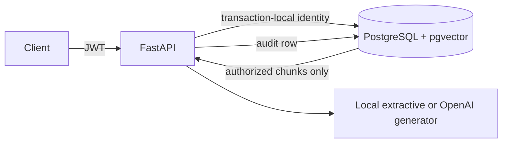

# RAG Guard

Permission-aware multi-tenant RAG demo using FastAPI, PostgreSQL, pgvector, and row-level security.



## Run

```sh
docker compose up --build -d
docker compose exec -T api pytest -m leakage -q
```

Open <http://localhost:8000>. Demo login: `admin@alpha.example` / `demo-password`. Other users use `employee` or `manager` and `alpha`, `beta`, or `gamma` in the same email pattern. The seed creates 60 documents with unique canary markers. `docker compose up` runs the migration and idempotent seed before starting the API.

The frontend is React with Vite. Compose builds it into the API image and serves it at port 8000. For frontend development, run `cd frontend && npm ci && npm run dev` while the API is running; Vite proxies API requests to port 8000.

To sign in as an existing demo employee, use `employee@alpha.example` / `demo-password` (or replace `alpha` with `beta` or `gamma`). To create another employee in an existing tenant, run:

```sh
docker compose run --rm migrate python -m scripts.create_user --tenant alpha --email new.employee@alpha.example
```

The command prompts for a password and creates an `employee` by default. The administrator database connection is used only by this one-off command; the API continues to use the restricted app role.

```sh
curl -s localhost:8000/login -H 'content-type: application/json' \
  -d '{"email":"employee@alpha.example","password":"demo-password"}'
```

Set `GROQ_API_KEY` to use Groq for answer generation (default model: `openai/gpt-oss-20b`). For example, put `GROQ_API_KEY=your_key` in a local `.env`, then run `docker compose up --build -d`. `OPENAI_API_KEY` also works; when both keys are set, Groq takes priority. Without either key, a local extractive generator makes the project runnable offline and keeps security tests deterministic. Groq is used only for answer generation. The local hash embeddings are useful for demonstrating the authorization path, but retrieval quality is limited; replace `app/embed.py` with a semantic embedding model for production use. Existing vectors must be re-embedded when changing models.

If chat returns a provider error, check `docker compose logs --tail=100 api`. Keep a Groq key under `GROQ_API_KEY`, not `OPENAI_API_KEY`. Provider failures are logged with the provider name and HTTP status without logging the key. The HTTP client sends a descriptive `User-Agent` because some API gateways reject Python's default client signature.

`/ingest` accepts text, Markdown, and PDF files, with `title`, `allowed_roles` (comma-separated, including `admin`), and `file` multipart fields. Only admins may ingest. `/chat` accepts `{"query":"..."}`. `/admin/audit` accepts optional `user_id`, `since`, `until`, and `limit` filters and shows only the caller's tenant.

## Security design

The retrieval query includes both tenant and role predicates before `ORDER BY` and `LIMIT`. Filtering after top-k selection can starve the result set and expose restricted rows to intermediate application code. RLS is a second database control: even `SELECT * FROM chunks` under an employee's transaction sees only that employee's permitted rows. The app role cannot bypass RLS. The test suite checks cross-tenant, cross-role, prompt, token, request-parameter, and raw SQL leakage. It also asserts that the retrieval SQL contains the required predicates; removing a predicate makes that test fail even while RLS still protects the database.

The HNSW index speeds larger vector searches. Filtered approximate search can return fewer than `k` rows, so retrieval enables pgvector's strict iterative scan in each transaction. Small datasets may use a sequential scan. See [pgvector filtering guidance](https://github.com/pgvector/pgvector#filtering) and [PostgreSQL RLS documentation](https://www.postgresql.org/docs/current/ddl-rowsecurity.html). The full threat table is in [THREAT_MODEL.md](THREAT_MODEL.md).

## Development notes

Run `docker compose logs migrate api` if startup fails. Set `POSTGRES_PASSWORD`, `APP_DB_PASSWORD`, and `JWT_SECRET` in a local `.env` before exposing the service. The Compose defaults are for local development only. No public deployment or demo video is included in this repository.
